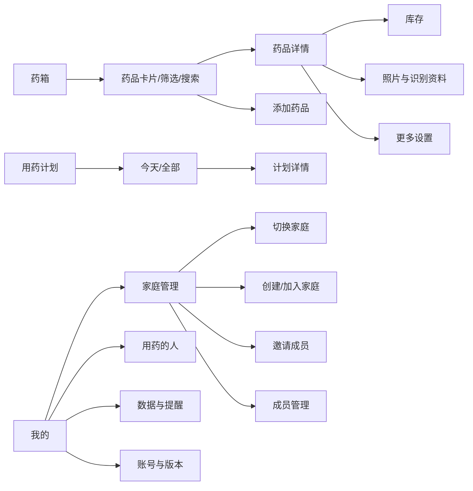

# 61 号计划：双端 UI 与交互大修（2026-10-25）

## 1. 任务状态

- 状态：`SPEC_READY / PENDING_EXECUTION`
- 基线：`main` / `7389ef14c35d87bec89306e040d8677c0f62d15e`
- 当前版本：`1.0.6`，Android build `12`，channel `candidate`
- 实施范围：微信小程序 + Flutter 页面布局、视觉与点击逻辑
- 实施边界：只改客户端表现层；不改 API 契约、数据库、家庭权限、照片归属、识别确认边界和业务数据流
- 真机输入：手机拍药盒、说明书后出现的药品详情页，以及 Jovi 对冗余、图片展示、识别预填和美感的反馈

本计划是执行交接规格。执行 AI 必须先审查当前仓库，再按本文实施；不得把本文当成已经通过真实功能验收的结论。

## 2. 最终目标

让用户用最少的判断完成一条高频路径：

```text
拍药盒/说明书/扫码
  -> 看懂每张图片识别出什么
  -> 核对少量核心字段
  -> 保存
  -> 从药箱卡片进入详情
  -> 快速查看图片、余量、效期和状态
```

整体体验应可信、温和、专业，突出药品图片、药名、库存和效期；低频资料存在但不抢主路径。

## 3. 已确认产品决策

| 主题 | 决策 |
| --- | --- |
| 实施范围 | 微信小程序与 Flutter 同步修改，保持同构体验 |
| 功能收纳 | 低库存、导出、变更记录、归档、删除进入“更多”；不删除已有数据 |
| 有效成分 | 删除独立主分类入口，数据保留在“包装与成分资料”折叠区 |
| 多照片识别 | 每张照片独立显示“图 1/图 2/图 3”原图与识别摘要，再汇总候选 |
| 候选覆盖 | 人工修改优先；用户改过的字段不能被后续识别自动覆盖 |
| 识别预填 | 允许预勾选用途、适用人群、用法用量；标注来源图片和“待人工核对” |
| 底部导航 | 改为 3 个 Tab：药箱、用药计划、我的；待处理并入药箱筛选和角标 |
| 家庭操作 | 首页只留当前家庭和切换入口；创建、加入、邀请、成员管理进入“家庭管理” |
| 录入顺序 | 先采集、后展开；首屏只突出拍药盒、拍说明书、扫码/相册 |
| 视觉方向 | 暖白 + 医疗绿 + 信任蓝，图文优先，状态同时用文字和颜色表达 |

## 4. 不变边界

1. 每次点击“添加新药”都打开空白录入，不自动恢复上一次未保存药品；只有用户明确点击“导入草稿”才恢复。
2. 识别结果只能成为待人工核对候选，不能自动保存、自动推断剂量或形成用药建议。
3. 药品规格、包装换算与库存数量/单位保持分离，不把包装数字自动解释成粒数。
4. 家庭、账号、私有照片、草稿、提醒和导出继续按现有身份与家庭隔离。
5. 不改 API URL、请求方法、字段名、权限校验、乐观锁、幂等键、照片上传生命周期。
6. 不删除历史字段或数据；界面删除入口只表示收纳，不表示清除。
7. 不做正式发布。候选只允许测试、预览和体验版；正式发布由 Jovi 另行批准。

## 5. 信息架构



### 5.1 底部导航

| Tab | 保留职责 | 不再承担 |
| --- | --- | --- |
| 药箱 | 药品列表、搜索、状态/用途/人群筛选、添加药品、待处理角标 | 家庭创建/邀请 |
| 用药计划 | 今天、全部计划、计划详情 | 无关的数据管理 |
| 我的 | 家庭管理、用药的人、提醒、数据、账号、版本 | 重复的药品管理入口 |

原“待处理”不删除功能：药箱首页显示角标和“待处理”筛选；筛选后每项仍直接进入对应短操作。

## 6. 视觉规范

### 6.1 颜色

| Token | 建议值 | 用途 |
| --- | --- | --- |
| `surface` | `#F7FAF8` | 页面暖白背景 |
| `card` | `#FFFFFF` | 卡片、输入区 |
| `primary` | `#2F7D5B` | 主操作、选中 Tab、关键图标 |
| `primarySoft` | `#E7F2EC` | 选中态、温和强调 |
| `trust` | `#3B6F9F` | 识别来源、资料链接 |
| `warning` | `#A86116` | 临期、待核对 |
| `danger` | `#B3423E` | 过期、失败、危险操作 |
| `ink` | `#20312A` | 标题和主要文字 |
| `muted` | `#607068` | 辅助文字 |

状态不得只靠颜色，必须同时显示文字或图标，例如“已过期”“库存待核对”“低库存”。

### 6.2 字体与间距

- 页面标题：20–22px / 40–44rpx，加粗。
- 药品名称：18–20px / 36–40rpx，加粗。
- 数量、效期等关键数据：16–18px / 32–36rpx。
- 正文：16px / 32rpx 起；不得继续使用 22rpx 灰色小字承载关键信息。
- 辅助说明：14px / 28rpx，且颜色对比度达到 WCAG AA。
- 标准间距采用 8rpx 基准：8 / 16 / 24 / 32 / 48rpx。
- 主按钮和关键触控目标不小于 88rpx；图片按钮必须有可见文字标签。
- 卡片圆角建议 20rpx，边框和阴影保持轻量，不做多层悬浮卡片。
- 折叠、图片进入和状态更新使用 150–300ms 的短过渡；不做持续装饰动画。

### 6.3 图片

- 药品封面图是列表和详情的视觉锚点。
- 图片使用固定宽高比，避免加载后页面跳动。
- 空图使用项目图标或药品轮廓占位，不使用 emoji。
- 所有照片提供明确的“图 1/图 2/图 3”编号。
- 点击照片进入只读大图；该图识别摘要与原图同屏或紧邻展示。

## 7. 页面规格

### 7.1 药箱首页

```text
┌──────────────────────────────────────┐
│ 当前家庭：123            [切换]      │
│ 药箱                      [＋添加]   │
│ [搜索药品.................]          │
│ [全部] [临期] [过期] [待处理 2]      │
│ [用途 ▾] [人群 ▾] [排序 ▾]           │
├──────────────────────────────────────┤
│ ┌────────┐  布洛芬缓释胶囊           │
│ │ 药品图 │  [已过期]                  │
│ └────────┘  余量 1 盒                 │
│             效期 2024-12-31           │
│             疼痛                     │
├──────────────────────────────────────┤
│ ┌────────┐  蒙脱石散                  │
│ │ 药品图 │  [正常]                    │
│ └────────┘  余量 2 盒 · 2027-03       │
│             腹泻                     │
└──────────────────────────────────────┘
```

规则：

1. 首屏只保留当前家庭、搜索、筛选、添加和药品卡片。
2. 卡片默认只显示药名、状态、数量、效期和最多一个核心标签。
3. 存放位置、完整用途、低库存、说明文本不进入默认卡片。
4. “待处理”是快捷筛选和角标；点击后仍可直接完成对应短操作。
5. 已有家庭时不再显示创建/加入家庭大表单。
6. 当前家庭切换入口是小按钮；家庭管理从“我的”进入。
7. 空状态使用图示 + 一句引导 + “添加第一种药”，不展示多层教程。
8. 保存新药后回药箱并轻量提示“已添加”；当前筛选不显示时明确提示并提供查看。

### 7.2 药品详情页

```text
┌──────────────────────────────────────┐
│ [返回] 药品详情              [更多]  │
│ ┌──────────────────────────────────┐ │
│ │           药品封面图             │ │
│ └──────────────────────────────────┘ │
│ 布洛芬缓释胶囊                       │
│ 20粒装 · 成人                         │
│ [已过期] [疼痛]                       │
├──────────────────────────────────────┤
│ 当前库存                  [修改余量] │
│ 1 盒                                 │
│ 有效期 2024-12-31                    │
│ 开封：未填写                         │
│ 位置：家庭药箱                       │
│ [新增批次]                           │
├──────────────────────────────────────┤
│ 照片与识别资料               [展开]  │
│ 图1 药盒 · 待核对                    │
│ 图2 说明书正面 · 待核对              │
│ 图3 说明书背面 · 待核对              │
├──────────────────────────────────────┤
│ [补拍]  [编辑资料]  [更多]           │
└──────────────────────────────────────┘
```

信息层级：

1. 药品身份：图片、药名、规格、状态、核心标签。
2. 当前库存：余量、效期、开封状态、位置，以及“修改余量”“新增批次”。
3. 照片与识别资料：分图缩略图、编号、识别状态、可展开摘要。

收纳规则：

| 内容 | 默认位置 | 是否保留 |
| --- | --- | --- |
| 药品名称、规格、厂家、品牌 | 详情主信息/资料区 | 保留 |
| 数量、单位、有效期、开封、位置 | 库存卡 | 保留 |
| 照片、来源、识别摘要 | 照片与识别资料 | 保留 |
| 有效成分 | 包装与成分资料 | 保留数据，删除独立主分类 |
| 个人剂量备注 | 更多 | 保留 |
| 低库存设置 | 更多 | 保留 |
| 导出 | 更多 | 保留 |
| 变更记录 | 更多 | 保留 |
| 归档 | 更多 | 保留 |
| 删除 | 更多底部危险区 | 保留 |

详情页底部只保留“补拍”“编辑资料”“更多”三个主要操作；库存短操作就近放置，不跳入整页编辑表单。

### 7.3 药品录入页

```text
┌──────────────────────────────────────┐
│ [返回] 添加药品              [草稿]  │
├──────────────────────────────────────┤
│ 1. 拍药盒                             │
│ ┌─────────┐ ┌─────────┐ ┌─────────┐  │
│ │ 拍药盒  │ │拍说明书 │ │扫码/相册│  │
│ │         │ │ 可多张  │ │         │  │
│ └─────────┘ └─────────┘ └─────────┘  │
├──────────────────────────────────────┤
│ 2. 核对识别内容                       │
│ [图1 药盒]  [查看原图]                │
│ 药名 布洛芬缓释胶囊  来自图1·待核对   │
│ 用途 [x]疼痛 [x]发热                  │
│ [展开图2识别] [展开图3识别]           │
├──────────────────────────────────────┤
│ 3. 核心资料                           │
│ 药品名称 *                            │
│ 数量 [  1  ] 单位 [盒 ▾]              │
│ 有效期 [2024-12-31]                   │
├──────────────────────────────────────┤
│ 包装与成分资料                 [展开] │
├──────────────────────────────────────┤
│ [保存药品]                            │
└──────────────────────────────────────┘
```

首屏采集入口：

1. 拍药盒：优先主要入口。
2. 拍说明书：支持连续多张；每张可删除、重拍、查看识别状态。
3. 扫码/相册导入：扫码命中资料或从相册选图后回到同一录入页。
4. 手动录入不是第四张大卡；未拍照时可直接在核心资料输入。

字段优先级：

| 层级 | 字段 | 默认状态 |
| --- | --- | --- |
| 核心 | 药品名称 | 始终可见，唯一必填 |
| 核心 | 数量、单位 | 始终可见，数量可空表示未知 |
| 核心 | 有效期 | 始终可见，尽量点选 |
| 分类 | 用途、适用人群、存放位置 | 识别有值时展示摘要，可展开 |
| 包装资料 | 品牌、厂家、规格、有效成分、批号、包装换算 | 默认折叠 |
| 说明书 | 原文、用途、用法用量、禁忌、注意事项 | 归入“照片与识别资料” |

折叠区必须显示“有 2 项识别内容待核对”之类的摘要，不能因默认折叠而隐藏未确认结果。

### 7.4 多照片识别展示

每张照片形成一个视觉区块：

```text
图 2 · 说明书正面                    [查看原图]
识别状态：已完成，待人工核对
用途摘要：缓解轻至中度疼痛……
用法用量：口服，一次一粒……
禁忌摘要：对本品过敏者禁用……
```

区块下方是“汇总候选”：

```text
已汇总 3 张图片
药品名称：布洛芬缓释胶囊   来源：图1
用途：疼痛、发热           来源：图1/图2
用法用量：……               来源：图2，待核对
```

合并规则：

1. 同字段多图一致时展示一个候选，并列出来源图片。
2. 同字段冲突时保留多个候选，不擅自选中；允许用户选择或手动输入。
3. 空字段可被识别候选填入。
4. 已由用户手动修改的字段永不自动覆盖。
5. 用户清除标签后，后续识别不得重新勾选同一批标签。
6. 自动预填内容必须带“来自图 N 识别，待人工核对”。
7. 保存只保存用户确认后的值；图片与来源摘要可继续保留为资料证据。

### 7.5 家庭管理

家庭选择页沿用 59 号已完成布局，不在本次重复重构；双端只需将其入口统一收进“我的 → 家庭管理”。

页面内分区：

1. 当前家庭：名称、角色、切换。
2. 创建或加入：默认折叠；无家庭时自动展开。
3. 邀请成员：只向管理员/有权限成员显示。
4. 成员管理：移除、退出、转让等操作与成员列表同区。
5. 危险操作：退出家庭、解散家庭等放入页面底部危险区。

邀请深链继续保留预览后确认加入的边界，不自动消耗邀请码；冷启动必须有明确首页/返回出口。

## 8. 点击逻辑优化

### 8.1 保留的点击

- 卡片进入详情。
- 图片进入原图/识别摘要。
- 数量、效期使用短面板原位修改。
- 分类和低频资料使用折叠区。
- 危险操作继续二次确认。
- 邀请加入、退出家庭、删除药品保留身份与权限确认。

### 8.2 删除或合并的点击

- 首页来源选择面板后又展示相同拍照入口的重复选择。
- 首页永远不可达的旧录入弹层。
- 详情页重复的说明书摘要。
- 详情页多处“新增库存/更多操作”。
- 为修改余量进入完整药品编辑页。
- 为展开有效成分进入独立主分类。
- 为待处理单独切换底部 Tab。
- 为家庭创建/加入在首屏反复跳页。

### 8.3 返回与草稿

1. 单位、日期、筛选、短面板取消后不得改变原值。
2. 有未保存修改时返回提供“继续编辑/放弃修改”；无修改直接返回。
3. 识别失败留在原页面，保留照片和手工录入入口。
4. 网络失败不得清空已填写字段、已选标签和已拍照片。
5. 保存失败保留幂等键、照片队列和当前表单。
6. 切换家庭时清除旧家庭投影和晚到请求结果。

## 9. 双端实施映射

### 9.1 微信小程序

优先文件：

- `apps/miniprogram/app.json`
- `apps/miniprogram/app.wxss`
- `apps/miniprogram/pages/index/*`
- `apps/miniprogram/pages/medicine-detail/*`
- `apps/miniprogram/pages/medicine-edit/*`
- `apps/miniprogram/pages/pending/*`
- `apps/miniprogram/pages/family-entry/*`
- `apps/miniprogram/pages/family-settings/*`
- `apps/miniprogram/pages/mine/*`
- `apps/miniprogram/components/business-nav/*`

实施要求：

- 3 Tab 导航需检查冷启动、分享页、邀请深链、详情返回和微信系统返回。
- 详情/录入 WXML 与 WXSS 同步调整，不能只隐藏字段而留下空白容器。
- 保留 `authEpoch`、`requestSeq`、`purposeTagsTouched`、草稿保存和照片补传逻辑。
- 删除死入口前先用测试证明没有业务 handler 使用它。

### 9.2 Flutter

优先文件：

- `apps/flutter/lib/main.dart`
- `apps/flutter/lib/features/home/production_shell.dart`
- `apps/flutter/lib/features/home/home_page.dart`
- `apps/flutter/lib/features/medicine/medicine_entry_api_page.dart`
- `apps/flutter/lib/features/medicine/medicine_detail_api_page.dart`
- `apps/flutter/lib/features/family/family_choice_api_page.dart`
- `apps/flutter/lib/core/widgets/medicine_tags.dart`

实施要求：

- 与小程序保持信息层级和功能入口一致，不要求像素完全相同。
- 保持 `moreExpanded`、请求序号、草稿队列、身份代次和照片生命周期。
- Android 大字体、键盘、320/390dp 宽度和横竖屏不得遮挡保存/导航。
- 不为视觉重构引入新的权限或网络依赖。

## 10. 不在 UI 批次内修复的问题

以下问题需要独立失败测试和独立提交，不能借 UI 重构顺手修改：

1. 小程序空请求体 `DELETE` 带 `application/json` 导致 Fastify 返回 `400 FST_ERR_CTP_EMPTY_JSON_BODY`，表现为删除成员失败。
2. 唯一 owner 解散家庭能力。
3. JSON 备份不含私照。
4. API `leave` 后 `active_family_id` 清理问题。
5. 邀请链接压栈、`FAMILY_NOT_FOUND` 导航等既有 P3 问题。

以下事项不得当作 UI 缺陷重新打开：

- Flutter 登录竞态。
- 创建录入 photo 锁表。
- 提醒 `send_started_at` 后不自动重发。
- invite 幂等。
- `x-family-id` 伪造越权防护。
- recognition 安全中文文案。

## 11. 建议实施批次

1. **共同规范**：建立双端颜色、字号、间距、状态标签和图片容器规范。
2. **药箱首页**：卡片墙、3 Tab、待处理筛选、家庭入口收口。
3. **药品详情**：三层信息、分图资料、库存短操作、更多收纳。
4. **药品录入**：采集入口、多照片区块、汇总候选、预填来源、折叠资料。
5. **家庭管理入口**：复用家庭页，收口重复入口。
6. **双端回归与真机验收**：测试、模拟器、手机预览/Android 安装验收。

每一批必须可独立审查；不要把 API 缺陷、版本发布和 UI 改动混在同一个提交中。

## 12. 验收清单

### A. 视觉与布局

- [ ] 微信小程序和 Flutter 都采用暖白、医疗绿、信任蓝的统一语义。
- [ ] 药品图片是首页卡片和详情页的主要视觉锚点。
- [ ] 药名、状态、数量、效期层级清楚，辅助文字不抢重点。
- [ ] 状态均同时显示文字和颜色。
- [ ] 关键触控目标不小于 88rpx / 44dp。
- [ ] 正文字号不小于 16px；关键数据和标题更大。
- [ ] 320、390 宽度及大字体下无截断、遮挡和不可点按钮。
- [ ] 键盘弹出时录入页保存按钮仍可达。
- [ ] 图片加载前后卡片尺寸稳定，不发生明显跳动。
- [ ] 页面中没有 emoji 图标或纯色块代替业务图标。

### B. 导航

- [ ] 两个端只保留药箱、用药计划、我的三个主 Tab。
- [ ] 待处理角标、筛选和短操作完整可用。
- [ ] 冷启动、邀请深链、详情返回、系统返回都有明确出口。
- [ ] 首页只显示当前家庭和小型切换入口。
- [ ] 创建、加入、邀请、成员管理统一从家庭管理进入。
- [ ] 首页不再显示不可达旧录入弹层。

### C. 药品详情

- [ ] 详情默认顺序为药品身份、库存、照片资料。
- [ ] 修改余量和新增批次可在库存卡完成，不要求进入完整编辑页。
- [ ] 低库存、备注、导出、历史、归档、删除均在“更多”可达。
- [ ] 独立有效成分主分类消失，数据仍能在包装与成分资料查看。
- [ ] 同一说明书摘要不再重复展示。

### D. 录入与识别

- [ ] 首屏突出拍药盒、拍说明书、扫码/相册，手动录入仍可直接使用。
- [ ] 说明书支持多张，每张都有独立编号、原图和识别状态。
- [ ] 每张照片可单独查看识别摘要。
- [ ] 多图结果可汇总为候选，冲突值不擅自选中。
- [ ] 用途、适用人群、用法用量可预填/预勾选并标注来源图片。
- [ ] 用户修改过的字段不会被后续识别覆盖。
- [ ] 用户清除标签后，后续识别不会重新勾选。
- [ ] 识别失败保留照片、字段和手工录入路径。
- [ ] 核心字段名称、数量、单位、效期位于首屏或一次滚动内。
- [ ] 品牌、厂家、成分、批号、包装换算默认折叠。

### E. 数据与安全

- [ ] 不改 API、数据库、契约、鉴权和家庭隔离。
- [ ] 新添加药品仍从空白开始，仅显式“导入草稿”可恢复。
- [ ] 草稿按家庭隔离，切换家庭不串照片、标签或表单。
- [ ] 保存失败、晚到识别、补传失败不丢用户修改。
- [ ] 删除、退出、归档继续确认并保留权限校验。
- [ ] 不把私照、真实家庭数据、凭证或原始识别日志写入文档、测试夹具和 Git。

### F. 自动化测试

- [ ] 小程序新增首页卡片、3 Tab、待处理筛选、详情收纳测试。
- [ ] 小程序新增多照片图 1/图 2/图 3、汇总候选、来源标记测试。
- [ ] 小程序新增用户修改不被覆盖、清标签不回填测试。
- [ ] 小程序保留登录竞态、家庭隔离、草稿、照片补传回归。
- [ ] Flutter 新增相同信息层级与交互行为 Widget 测试。
- [ ] Flutter 保留候选展开、请求序号、草稿队列回归。
- [ ] lint、typecheck、build 全部通过。
- [ ] 小程序官方 WXML/WXSS 编译通过。
- [ ] API 不改时仍运行既有相关回归，确认契约未受影响。

### G. 真机验收

- [ ] 微信开发者工具完成登录、家庭切换、拍盒、多说明书、识别、保存、重开详情。
- [ ] 微信手机预览完成同一主路径，记录异常原文和截图。
- [ ] Android 真机完成同一主路径，检查大字体、键盘、返回和图片。
- [ ] 至少双账号/双设备确认家庭切换与药品可见性没有串数据。
- [ ] 不卸载应用、不清理用户数据，验证升级后草稿和历史药品仍在。
- [ ] 只上传体验版或安装候选，不擅自提交审核/正式发布。

## 13. 完成定义

只有同时满足以下条件，才可从 `SPEC_READY` 进入 `IMPLEMENTED`：

1. 双端页面按本文完成，信息架构和字段收纳一致。
2. 自动化测试通过，失败项有可重复证据；Windows 平台限制不得写成代码通过。
3. 至少完成微信预览和 Android 候选的主路径真机检查。
4. 独立代码审查无 P0/P1 问题。
5. 回执包含：改动说明、测试结果、截图/验收矩阵、版本与 Git SHA、部署边界。
6. API 仍使用当前已部署身份；小程序未正式发布。

## 14. 远端完整执行任务包

执行 AI 应把本文件作为自包含阶段任务，完成以下完整工作后再提交 GitHub：

1. 读取仓库目录、`AGENTS.md`、本计划、当前进度与相关测试。
2. 可研究可借鉴的医疗/家庭库存产品导航和多图识别交互，但不复制第三方受保护素材。
3. 独立审查本计划与当前代码的差异，列出冲突后按本文边界解决。
4. 同步实现微信小程序与 Flutter 的 UI/交互大修。
5. 先补失败测试，再实现并修复至相关测试通过。
6. 执行独立代码审查，修复发现的问题并复验。
7. 生成脱敏实现回执，包含验收清单逐项状态。
8. 使用中文提交信息提交并推送 GitHub；不合入 API 缺陷或发布操作。
9. 本地 Codex 只接收该完整阶段并复验，不承接远端的半成品计划。

