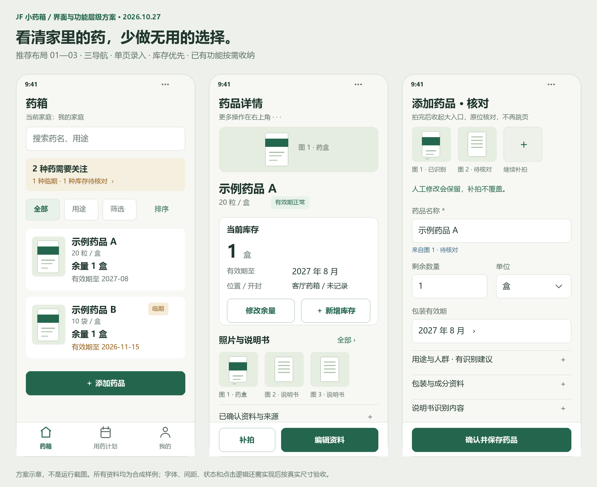
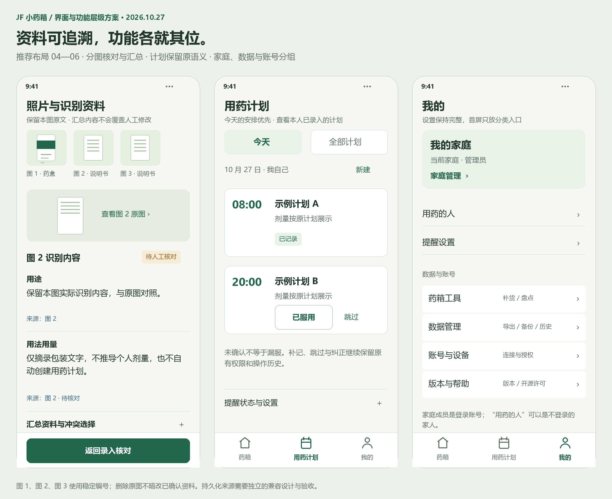
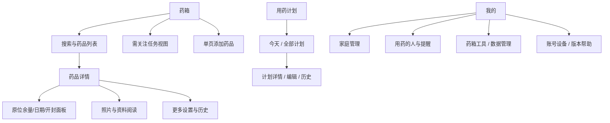

# JF小药箱：界面与功能层级大修方案（2026-10-27）

状态：**IMPLEMENTATION_IN_PROGRESS**。Jovi于2026-10-27回复“执行吧”，授权按本方案实施；设计阶段的复审、编译/测试与布局稿保留为基线证据。当前实际进度以`tasks/todo.md`和最终验证回执为准。

基线：`21428be477f914c791408db329d7b3bd6bfd6bb5`，`codex/ui-overhaul-p0-20261026`，`1.0.6+13 candidate`。

本方案继承Jovi已确认的双端、三导航、不删历史数据、多图来源、人工优先和暖白医疗绿方向；把61号规格中尚不够明确的交互、状态和技术边界具体化。技术事实以[本轮复审](../reviews/2026-10-27-ui-reaudit.md)为准，已解决问题不重新开单。

## 1. 明早先看这一页

**推荐：保留现有可靠业务能力，重排信息层级，收口录入与图片状态，按可验收的完整路径分批改。**

用户最常做的三件事是：找药、记录库存、核对包装资料。首屏应围绕这些任务安排，而不是把所有字段、提醒和设置同时展示。

| 现在的阻力 | 推荐结果 |
| --- | --- |
| 首屏多排统计、筛选、说明和入口 | 一个当前家庭入口、一条关注摘要、搜索/简短筛选、图文药卡、一个添加入口 |
| 详情顶部长说明书，把库存压到下方 | 药品身份 → 当前库存/效期 → 照片与资料；设置进入更多 |
| 拍盒与拍说明书入口分散，拍完仍像长表单 | 一个录入页：初始采集入口，拍完缩为照片条，原位核对核心字段 |
| 多张照片仅表现为张数 | 每图有稳定编号、原图、识别内容和状态；字段可追溯到图几 |
| 后续识别重新填回主动清空的内容 | 人工输入、人工取消和人工清空始终优先 |
| 选填资料也长期触发“待补资料” | 库存/日期问题优先；选填资料建议默认收起，不占首页报警位 |
| 页面功能分散，低频设置像主任务 | 三Tab；家庭统一管理；“我的”页内分组；短操作原位完成 |

今晚采用的推荐决策：

1. 手机药卡保持**单列图文**，不改成双列商城格；长药名、日期和大字体更容易阅读。
2. 两端均用**药箱 / 用药计划 / 我的**；“待处理”保留为药箱内的筛选与任务视图。
3. 录入保持**同页**，不新增强制“拍照页→识别页→分类页→保存页”。
4. 图片/说明书作为资料，库存是详情主操作；用途摘要只显示一次。
5. 所有现有功能继续可达；删除重复入口和无用展示，不删除历史数据。
6. “图几识别出什么”的跨设备持久化作为独立增量设计，不能假装只改文案就已完成。

## 2. 两张布局稿

以下是离线绘制的**方案示意**，不是应用运行截图，也不表示功能已实现。药品、照片和计划均为合成样例。





图中的录入页是“拍完后的核对态”；初始未拍照时显示拍药盒、拍说明书、扫码/相册三入口。已有照片后不再同时堆放完整大入口。

## 3. 三种路线与选择理由

| 路线 | 能得到什么 | 不足 | 决策 |
| --- | --- | --- | --- |
| A 只换色、字重和边距 | 变化快，改动小 | 导航、重复操作、来源和长表单仍在；当前代码已经证明不足 | 不采用为主路线 |
| B 重排功能层级 + 定向状态收口 | 同时减少首屏噪音、跳转和误覆盖；复用现有API与业务流程 | 需要双端同步、行为测试及多图增量契约 | **采用** |
| C 换框架/全站重写/强制多步向导 | 外观可彻底重做 | 重新承担登录、权限、草稿、照片和部署风险，普通录入反而多跳几页 | 不采用 |

大修的重点是任务组织和交互状态，视觉规范为其服务。当前主色、可用回归和已修隔离逻辑应保留。

## 4. 页面与功能归属

### 4.1 一级到三级



- 一级只有三个Tab。
- 二级承载独立任务：详情、录入、计划、家庭管理、导出等。
- 三级面板只做短选择：数量、单位、日期、筛选、确认；说明书长文不塞进窄小选择面板。
- “我的”中的工具、数据、账号是**页内分组/展开区**，不是每组新增一个强制中转页。
- 录入和编辑页保留标题返回与固定保存栏，不同时固定完整Tab栏和保存栏。冷启动邀请/无历史栈页面仍有明确“返回药箱/家庭管理”出口。

### 4.2 现有25个小程序路由逐项安排

这里只改变用户可见层级，不随意重命名既有路径。

| 当前页面 | 新归属/入口 | 操作方式 |
| --- | --- | --- |
| `login` | 必要时登录 | 成功回原意图；有效会话不重复登录 |
| `family-entry` | 家庭切换/无家庭引导 | 复用已完成的渐进展开；已有家庭优先选择 |
| `index` | 药箱Tab | 找药、关注、添加 |
| `family-create` | 家庭管理→创建 | 保留确认，不在首页平铺 |
| `medicine-edit` | 添加/编辑药品 | 同页采集与核对 |
| `medicine-detail` | 药卡 | 身份、库存、照片资料 |
| `batch-edit` | 详情→新增/完整编辑一份库存 | 短改余量不必进入此页 |
| `export-preview` | 数据管理/单药更多 | 预览后分享；范围必须清楚 |
| `invite` | 家庭管理/微信深链 | 按身份显示生成或接受；预览后确认 |
| `pending` | 药箱→需关注 | 移出原生Tab；保留路径及任务深链兼容 |
| `medication-plans` | 计划Tab | 默认今天，全部计划页内切换 |
| `plan-detail` | 计划卡 | 计划说明、状态、历史入口 |
| `plan-create` | 计划→新建/编辑 | 保留已有剂量、权限和冲突语义 |
| `release-notes` | 我的→版本帮助 | 调试入口继续留静态版本标题 |
| `care-profiles` | 我的/计划就近选择 | 文案“用药的人”；仍用现有照护权限 |
| `mine` | 我的Tab | 页内分组 |
| `family-settings` | 我的→家庭管理 | 成员/邀请/角色；库存工具移到工具区 |
| `app-link` | 账号与设备→连接Android | 保留真实临时连接码协议 |
| `stocktake` | 药箱工具/需关注任务 | 按批次核对，保留冲突反馈 |
| `restock` | 药箱工具/低库存任务 | 保留补货状态和数量单位 |
| `trash` | 数据管理→最近删除 | 恢复与权限原样保留 |
| `audit` | 数据管理/单药更多 | 家庭历史与单药历史区分范围 |
| `backup-restore` | 数据管理 | 清楚说明备份范围，不借UI增加私照备份能力 |
| `notification-settings` | 我的→提醒设置 | 显示真实平台授权与送达状态 |
| `account-settings` | 账号与设备 | 显示名/退出与家庭退出分开 |

照片资料的推荐实现：录入页内嵌精简逐图核对；保存后的完整阅读，小程序新增一个有明确用途的`medicine-photos`页，Flutter复用`leaflet_photo_page.dart`。这是本方案唯一建议新增的主业务阅读页，不是新增录入步骤。

## 5. 药箱首页

### 5.1 默认可见

从上至下：标题和当前家庭切换、搜索、关注摘要（有需处理项才显示）、简短筛选、图文单列药卡、一个持续可达的“添加药品”。

药卡默认展示：封面、药名、余量、最早管理期限、必要状态。规格作为次级识别信息；最多一个核心用途标签。位置、厂家、成分和长用途移到详情。无封面显示统一图标，不因识别失败阻止录入。

添加按钮只有一个主入口，固定于一级页面安全区域；列表预留其占位，最后一条不被遮住。搜索与筛选在返回后保留，保存后沿用现有高亮能力。

### 5.2 关注摘要与待处理

- 默认优先过期、临期、需核对库存/开封日期、已启用的低库存提醒。
- 选填厂家、成分、说明书缺失不是录入失败，放到“资料完善建议”折叠组，不占首屏红点。
- 不自动补成分或替用户确认说明书。待核对资料仍能查看，只降低默认展示优先级。
- 首页数字按**相关药品ID去重的种数**；展开后显示具体任务。家庭盘点这类`medicineId=null`任务单列“药箱盘点”，不伪造一种药。
- 计数与点击结果使用同一个展示集合，不把种、盒、批次相加。
- 为避免两端现有待处理算法继续分歧，优先复用现有`GET /api/v1/notifications/pending`结果做客户端分组；现阶段不改服务端任务语义。
- 单项点击直接到目标药品/库存/补货/盘点；不先跳一个重复总览页再要求用户重找。

搜索只有关键词清除；重置筛选是独立操作。无结果展示已选条件和清除入口，不将空筛选误写成“药箱没有药”。

## 6. 药品详情

### 6.1 结构

1. **身份区**：约96–144逻辑px高的紧凑封面预览，原图等比例置入，点击可看完整原图；随后是药名、规格、必要标签和状态。厂家仅作小型识别资料，不重复显示。
2. **库存区**：当前在库批次、余量、效期、位置、开封状态。默认展开；多批次保留各自日期和单位，不强行汇总不同单位。
3. **照片与资料区**：缩略图条、图号、原图和核对状态；摘要只有一处；长文展开阅读。

“修改余量”直接打开短面板；有效期、开封也就近编辑。完整批次编辑仍存在。用户文案“新增一份库存（同款不同日期）”，内部继续使用batch和原API。

### 6.2 更多与主要操作

- 底部只保留“补拍”“编辑资料”；右上“更多”提供低库存设置、个人剂量备注、创建用药计划、导出、变更记录、归档、删除。
- 更多不是让所有操作多一页：先用可滚动动作面板，短设置就地完成，长任务继续用原页面。
- 资料中的有效成分、厂家、批准文号放在“包装与成分资料”。如现有核对/冲突警示需要用户处理，该区自动展开且指出原因。
- 删除药品、删除一份库存、移除照片分别命名，不用一个含混“删除”。沿用原确认和权限。
- 单药导出必须明确标注范围；若现有接口只能整箱导出，就写“导出药箱清单”，不假装单药导出。

## 7. 单页录入与多图核对

### 7.1 初始态与采集后态

初始态首屏为三入口：拍药盒、拍说明书、扫码/相册。未拍照也能直接手填药名。每次新添加为空白，恢复旧草稿需显式点击。

采集后大入口收为照片条与“继续补拍”；名称、数量/单位、效期紧随其后。分类、人群、包装、开封和批号按需展开。出现候选歧义时，只自动展开区分候选所必需的厂家/规格，不展开全部高级字段。

数量留空表示未知，0表示明确耗尽；日期可以未知，只有年月就保留年月。不得为了让表单看起来完整而默填0或今天。

### 7.2 每图最小信息

| 信息 | 规则 |
| --- | --- |
| 稳定图号 | 新增递增；删除图1后不把原图2改成图1 |
| 稳定照片ID | 本地UUID，上传回执后绑定服务器photoId；不能只靠数组下标 |
| 类型 | 药盒、有效期、说明书；说明书正反面是展示标签，不扩充医学推断 |
| 状态 | 待读取、识别中、待核对、失败可重试、已确认、待补传 |
| 本图内容 | 原图、实际识别字段与警告；不是所有照片共享一个汇总文本 |
| 操作 | 查看原图、重试此图、补拍、移除；不影响其他图已完成结果 |

默认顺序执行识别，提供每图进度，复用现有尺寸和配额限制。不在本次要求新建后台队列服务，也不为了批选引入新相机权限。

### 7.3 汇总、来源与冲突

- 每字段显示来源，例如“来自图2，待核对”；同值多图显示“图1、图3”。
- 药名、厂家、批准文号、规格和日期发生冲突时并列原值，由用户选择；不采用“最后一图获胜”。
- 只归一化已定义且安全的显示差异（如首尾空格）；不自行认定不同药名、规格、日期精度或单位等价。
- 用途/适用人群可按识别结果预勾选并标待核对；缺少正面依据、否定句或禁忌文字不应反推用途、人群。
- **用法用量是原文摘要，不是个人服药方案，也不是按年龄推算的数字。** 不自动创建计划、选择剂量或扣库存。
- 点击保存表示确认将当前核对后的值保存；未处理的药品身份冲突需先明确选择，其余选填空值允许保存。图片资料的“待核对”状态独立保留。

### 7.4 人工优先的字段状态

| 状态 | 新识别可以自动写吗 | 用户动作后的状态 |
| --- | --- | --- |
| 从未填写 | 可以给建议，仍待核对 | 输入后为人工修改 |
| 自动建议 | 仅一致值可自动合并；冲突需选择 | 改动后为人工修改 |
| 人工修改 | 不可覆盖 | 用户再次编辑仍为人工修改 |
| 人工清空/取消全部 | 不可重新填回 | 只有明确“使用识别建议”才接受新建议 |

状态必须随草稿持久化。分别覆盖识别前修改、识别期间修改、扫码候选、恢复草稿和继续补拍。旧`purposeTagsTouched`、成分确认绑定、请求代次和照片所有权保护继续保留。

删除草稿照片时，去掉它未接受的建议并重新计算冲突；已经人工确认的字段不暗中清除。保存后移除原图时明确提示“已保存资料保留，原图将不可查看”，来源状态改为“原图已移除”，不把其他图错配过去。

## 8. 其他页面与返回逻辑

### 8.1 家庭

- 首页家庭按钮只打开短切换列表；0家庭进入创建/加入；1家庭不强迫每次再选；多家庭显示当前标记和角色。
- 创建、加入、邀请、成员、转让和退出统一进入家庭管理；沿用已验证的家庭选择页，不重复重写。
- 邀请深链保留目标家庭，登录后回预览；已有其他家庭不要求先退出或删除。加入前不切换现有家庭，不提前消耗邀请码。
- 冷启动无历史栈时提供“返回药箱”和“家庭管理”；错误提示不因折叠或压栈不可见。
- 切家前处理未保存输入，成功后同步清旧视图，失败不误清当前有效数据。

### 8.2 用药计划

- 今天优先；全部计划页内切换，不同时平铺两套长列表。
- 选择“用药的人”就近完成；账号成员与照护对象名称分开。
- 卡片保留“已服用”“本次跳过”和原有纠正/补记，不以含混“记录”增加一次必经跳转。
- 提醒授权提示只在需要时出现；投递明细、权限和历史按需展开，不抢在今日任务之前。
- 原有幂等、计划撤销、权限、未知请求结果和提醒送达语义不变，不把UI完成当成通知已送达。

### 8.3 我的

默认展示当前家庭入口、用药的人/提醒，以及工具、数据、账号、版本的页内分组；取消大块重复九宫格。

工具：补货、盘点和盘点频率。数据：导出、备份恢复、变更记录、最近删除。账号与设备：显示名、登录会话、Android连接、退出。版本帮助：更新与开源许可。

现有不支持的产品能力不借文案宣称存在；例如备份范围要清楚说明照片原件是否包含，唯一管理员退出仍受现有规则约束。

## 9. 视觉与可访问性

| 项目 | 推荐基准 |
| --- | --- |
| 背景 | 暖白`#F7F8F4`，卡片白色；适量留白，不处处嵌套卡片 |
| 主色 | 保留现有医疗绿语义，建议统一到`#24664D`；已可用`#047857`可在第一批保留，最终全端统一一次 |
| 文字 | 深绿灰主字；辅助字保持对比；不用大量浅灰细字作为说明 |
| 字号 | 正文/核心输入至少16逻辑px；药名18–22；主数值24–32；辅助标签13–14 |
| 缩放 | Flutter用可缩放文本；小程序不能仅凭32rpx就认定所有屏宽达16px，320宽需单验 |
| 触控 | 主操作和图标点击外框按48逻辑px设计；不把可见字形大小当热区大小 |
| 状态 | 过期/临期/未知/失败同时有文字；不能只用红点或背景颜色 |
| 图片 | 固定预览外框、等比例置入原图、同尺寸加载/失败占位；身份切换即移除旧图 |
| 图标 | 项目现有矢量/平台图标，同一线宽；清掉作为系统入口的emoji |
| 动效 | 展开/状态反馈短过渡；减少动态效果设置下可关闭；不做装饰性持续动画 |

48逻辑px是本项目的易点按设计目标，不把它误写为WCAG AA的统一强制阈值。[W3C 2.5.8说明](https://www.w3.org/WAI/WCAG22/Understanding/target-size-minimum.html)的最低尺寸为24 CSS px并有例外；移动端本项目采用更大的目标。

支持320/390宽、横屏和2倍文字。大字可以增加页面高度，关键内容允许换行；不靠缩小字体和隐藏错误来让测试通过。

## 10. 照片加载与数据边界

### 10.1 缓存收口

新建由`AppServices`持有的实例级私有图片加载器，首页/详情共用；key包含来源、已验证用户/家庭、身份代次、药品/照片ID和显示尺寸。无有效作用域时不展示旧图。

切家、退出、撤权或API身份变化时失效；读取完成前后复核原身份；处理旧Future、失败重试和封面变更。原图不放进永久全局字节Map。初始预算建议24条且总字节≤24MiB，实测后可收紧；缩略图按显示尺寸解码，原图按需打开。预算属于设计起点，不是本轮性能实测。

`Future`在受控生命周期内取得，不在`build()`里无条件创建新下载；参照[Flutter官方FutureBuilder说明](https://api.flutter.dev/flutter/widgets/FutureBuilder-class.html)。

### 10.2 必须明确区分的三层改动

| 层 | 内容 | 范围 |
| --- | --- | --- |
| A 页面与导航 | 颜色、顺序、折叠、三个Tab、家庭入口、短面板 | 复用既有API；改变展示和导航，不改服务端语义 |
| B 录入草稿 | 稳定图号、逐图结果、人工修改状态、汇总冲突 | 客户端本地状态/草稿兼容增量，已超出单纯WXML排版 |
| C 保存后跨设备追溯 | 每图识别内容、字段来源和核对记录 | 需要可审查的服务端可选契约与增量迁移，不能假装当前API已有 |

**推荐完整目标包含C，但必须独立实施和验收。** 若Jovi晨审只批准A/B，交付只能标“本机录入可逐图核对”，不能声称“保存重开/家人手机可追溯”。

### 10.3 C层的最小推荐设计

- 客户端先以稳定`clientPhotoId`关联结果，沿用现有图片上传回执得到`photoId`，再提交来源元数据；不重建图片上传、幂等和清理通道。
- 建议增加一个按药品读取/更新的可选`recognition-evidence`资源。包含schemaVersion、文档revision、照片与图号、各图识别字段/状态、字段选定来源和人工核对标记。
- 所有引用照片须属于当前家庭、当前药品且已完成上传；写入需当前身份、revision和幂等键。新资源失败不把已保存药品谎称失败，也不重发创建药品；界面明确“药品已保存，资料来源待同步”，保留补传状态。
- 现有`getMedicine`和图片API不因旧客户端缺字段而失败。新客户端遇到旧服务器缺能力时明确降级；不能静默丢来源后仍显示已完整同步。
- 对照片数、单字段长度、总证据字节数设服务端上限；建议起点为单图文本≤32KiB、单药证据≤256KiB，数值需由实施阶段测试验证，不改变当前照片原件配额。超限时明确拒绝并保留本机原文，不静默截断。
- 历史记录保持“未记录逐图来源”；不批量重识别、不伪造图号或“已确认”。
- 来源元数据纳入同批结构化备份/恢复合同；照片原件是否包含继续如实说明，不顺带重写备份系统。
- 删除图片后来源引用变为不可查看；已确认药品字段不被暗删。照片、资料与个人剂量仍按原权限隔离。

本轮只提出此契约，没有创建接口、表或迁移文件。

## 11. 给执行AI的分批实施计划

Jovi已指示执行本完整方案。按下列批次连续推进，范围内普通实现选择不反复征询；生产维护和正式发布仍按各自授权及准入门槛处理。

### P0 先收口正确性与图片边界

- 目的：解决当前缓存作用域和重复摘要，保留R01/R02/R03/R04已通过的修复。
- 前置：重新固定实际HEAD和脏树；若另一AI更新了同一工作区，先比较提交，不能覆盖。只对本批相关代码做定向整理。
- 改动：小程序`pages/medicine-detail/*`；Flutter`data/app_services.dart`、`features/home/production_shell.dart`、`features/medicine/medicine_detail_api_page.dart`；新增`core/widgets/private_medicine_image.dart`。
- 新测：`apps/miniprogram/test/medicine-detail-display.test.mjs`、`apps/flutter/test/private_medicine_image_test.dart`。覆盖同作用域重建、身份变化、照片删除/更新、失败重试、迟到结果、摘要只出现一次。
- 验证：根`npm run lint`、`npm run typecheck`；两个目标测试文件与Flutter analyze。缓存探针的新期待是客户端B不再得到A旧字节，未被授权的照片请求仍被原API拒绝。
- 失败/回退：保留固定占位和原鉴权；不退回进程级共享Map。移除本批候选补丁，不改线上部署。
- 可标状态：`CORRECTNESS_INCREMENT_VERIFIED`，不能标全部UI完成。

### P1 导航、首页和家庭归位

- 目的：让三个主入口一致，找药、关注、切家庭不绕路。
- 前置：P0通过；路由/返回验收表先写好。
- 小程序：`app.json`、`components/business-nav/*`、`pages/index/*`、`pages/pending/*`、`pages/mine/*`、`pages/family-entry/*`、`pages/family-settings/*`、`pages/invite/*`；新增`services/navigation.ts`用于统一已有路由意图，不自行发业务写请求。
- Flutter：`app.dart`、`features/home/production_shell.dart`、`features/my/my_page.dart`、`features/family/family_choice_api_page.dart`、`features/pending/pending_page.dart`。
- 保持兼容：小程序`pending`仍在pages列表但移出tabBar，检查全部旧`switchTab`调用；Flutter原`/home?tab=pending`落到药箱关注态，`my`索引由3迁为2；旧链接不能落到错误Tab。
- 小程序三Tab迁移须同步原生Tab与自定义导航。录入页保留草稿离开守卫，深链无栈提供明确出口；不为了减按钮删除邀请逃生路径。
- 新测：`three-tab-navigation.test.mjs`、`cabinet-attention-view.test.mjs`、Flutter`three_tab_navigation_test.dart`、`cabinet_attention_view_test.dart`。
- 验证：有/无历史栈、0/1/多家庭、邀请前/后、取消切家、筛选数字与列表、药箱级盘点任务、返回搜索/滚动/当前家庭；官方模板编译与隔离QA。
- 失败/回退：保持旧路径可解析；回退本批导航，不改存储或后端；未完成双端路径时仅标路由候选。
- 可标状态：`NAVIGATION_AND_HOME_CANDIDATE`；真机另验。

### P2 详情、录入首屏与全局视觉

- 目的：按任务排序字段，减少长表单、重复设置和层层卡片。
- 小程序：`app.wxss`、`app.json`原生颜色、`pages/medicine-detail/*`、`pages/medicine-edit/*`、`pages/batch-edit/*`、`pages/medication-plans/*`、`pages/mine/*`。
- Flutter：`core/theme/app_theme.dart`、`core/widgets/app_surfaces.dart`和对应正式页面；只提炼这些页面确实共用的小组件，不做全工程架构重写。
- 按本方案详情顺序和录入两态实施；常用短操作原位完成；更多内每个功能继续可达；长文本不复制成多份。
- 新测：`medicine-entry-hierarchy.test.mjs`、`medicine-detail-actions.test.mjs`；Flutter`medicine_detail_layout_test.dart`、`medicine_entry_hierarchy_test.dart`。
- 验证：320/390宽、2倍字体、长药名/厂家、多批次、无照片/照片失败、键盘、固定栏、状态文字；用正式组件和正常入口做点击测试。
- 失败/回退：保留数据绑定、handler、校验和来源状态。不能将删除控件连同数据一起删除；不能改小字体来凑布局通过。
- 可标状态：`DUAL_CLIENT_LAYOUT_CANDIDATE`，不包含尚未实现的逐图来源承诺。

### P3 本地逐图核对、冲突与人工保护

- 目的：录入时能回答“图几识别出什么、哪些字段是我改过的”。
- 小程序：`pages/medicine-edit/medicine-edit.ts/wxml/wxss`；新增纯规则模块`services/recognition-review.ts`，与现有照片所有权/持久队列保持接口。
- Flutter：`features/medicine/medicine_entry_api_page.dart`、`data/medicine_draft_queue.dart`；新增`domain/recognition_review.dart`和小型照片核对组件。
- 草稿新增schemaVersion、稳定clientPhotoId/图号、每图结果、字段来源/状态；旧草稿可读，缺来源写“未记录”，不自动恢复到新添加页。
- 新测：两端`recognition-review`纯规则测试；追加真实录入handler/Widget测试，涵盖识别前/中手动清空、取消全部人群、扫码、三图冲突、删除中间图、恢复、保存未知结果和补传。
- 验证：本地队列写失败/返回false时不离开或误显示已保存；家庭变化不写入新作用域；批次结构变化不把有效期填到别的库存。
- 失败/回退：保留原草稿与原件；不要按“旧版本草稿”名义清空或批量删除。新字段可忽略但必须保护旧内容。
- 可标状态：`LOCAL_MULTI_PHOTO_REVIEW_VERIFIED`；此时还不能宣称跨设备逐图来源完成。

### P4 保存后的来源资料与双端阅读

- 目的：保存重开、其他已授权设备也能查看每图内容与选定来源。
- 前置：Jovi审核第10.3节的数据范围；P3稳定；源数据备份/恢复和兼容测试方案明确。生产服务维护另走原有部署准入。
- 契约：`packages/contracts/src/index.ts`、小程序`services/api-types.ts/api.ts`、Flutter`models/medicine_models.dart`及`data/api_workflow_repository.dart`增加可选证据资源DTO。
- API：新增`apps/api/src/routes/recognition-evidence.ts`及注册；在当前家庭/药品行锁和照片归属约束下验证引用、revision、幂等和大小边界。
- 迁移：当前最大文件前缀034，建议新建`apps/api/db/migrations/035_photo_recognition_evidence.sql`；实施时若该号已被新提交占用，按最新迁移器规则选择下一个可用号，禁止改已发布SQL/校验值。
- 客户端：小程序新增`pages/medicine-photos/*`；Flutter复用`leaflet_photo_page.dart`。照片页只读展示与原图查看不触发重新识别；重新识别必须显式操作。
- 新测：API`recognition-evidence.test.mjs`及真实隔离PG用例；两端旧服务降级、三图保存重开、撤权、跨家引用拒绝、旧客户端读取、幂等重试、照片移除、备份恢复回归。
- 验证：用一次性回环PG，显式`REQUIRE_POSTGRES_TESTS=1`运行API全套；无隔离PG则此门槛为NOT_RUN，不能指向生产库。并跑新旧客户端契约和本批备份恢复测试。
- 失败/回退：新能力失败不能重复创建药品；来源待同步独立重试。添加性迁移保留新列/表，回退客户端/API时旧路径仍能工作，不执行破坏性生产降级SQL。
- 可标状态：`PERSISTENT_EVIDENCE_CANDIDATE`，还需真实双设备验收。

### P5 固定候选、独立审核与交付

- 目的：交付一个有身份、可实际验收的完整候选。
- 建议最终用户版本`1.1.0 candidate`；Android build大于构建时最新值。根VERSION、APP_VERSION、pubspec、两端版本说明一致；本轮文档不修改现有1.0.6+13。
- 冻结后运行根lint/typecheck/build、小程序全套、QA、官方编译、Flutter analyze/test及所需Android构建。P4涉及API时补真实隔离PG、迁移、备份恢复和合同测试。
- 生成隔离HTTPS小程序候选，不上传原始loopback源码工程；固定SHA、源码树、CI、API地址、包摘要、迁移清单。
- 独立审查必须执行关键失败用例，不只读任务勾选；修复后重新固定身份。已跳过项如实保留。
- 手机保数据覆盖升级须满足现有签名/设备门槛；不卸载、不清缓存或数据库来掩盖问题。微信预览/体验和正式发布分开记录。
- 交付包含完整验收矩阵与未验项；中文提交并推送GitHub供另一方接收。推送、合并、部署按Jovi当时授权执行，当前“只方案”不授权这些动作。
- 可标状态：`CANDIDATE_VERIFIED`；只有实际设备与服务准入通过后，才记录相应真实验收，不自行宣布正式上线。

## 12. 编译、查看与验收方法

### 12.1 今晚已经执行的内容

1. 当前HEAD代码和最近整改对照，25个现有小程序路由、Flutter正式壳/页面审阅。
2. lint、类型、构建、小程序559项、QA38项、Flutter790项与分析；跳过数另记。
3. 官方28 WXML/29 WXSS编译；小程序真实方法的隔离探针；Flutter正式组件的中文标签、图片高度/次数与缓存作用域探针。
4. 查看320宽/2倍字的录入截图和修复后的首页/详情截图；区分宿主渲染和真机。
5. 两张离线布局稿逐张查看。没有修改应用实现。

原始证据及运行边界见[本轮复审](../reviews/2026-10-27-ui-reaudit.md)。小程序隔离模拟器被touristappid准入拒绝，本轮未替换真实AppID绕过；实际模拟器业务仍未验。

### 12.2 实施时每批的编译顺序

1. 固定本批源码身份，先跑小型纯规则/handler测试。
2. 小程序模板与样式按完整依赖分组编译；Flutter先analyze与目标Widget。
3. 用隔离合成身份和当前源码生成的工程查看，不混用旧副本截图；截图记录来源SHA、屏宽、字体尺度和场景。
4. 沿正常入口实际点击，不直接伪造成功状态就宣布主路径通过。
5. 通过后才跑必要的完整回归、制作固定候选。发现具体风险才增加测试，不反复重跑无关套件。

常规命令：

```text
npm run lint
npm run typecheck
npm run build
npm run test --workspace @home-medicine/miniprogram
npm run test:mini:qa
npm run check:miniprogram:source
E:/AI_Tools/Other/Flutter/bin/flutter.bat analyze --no-pub
E:/AI_Tools/Other/Flutter/bin/flutter.bat test --no-pub --reporter expanded
```

Flutter命令工作目录为`apps/flutter`。官方编译脚本的release门禁与源码检查不是一回事；release检查应在生成的HTTPS候选上进行，不把原始源码被拒绝当编译缺陷，也不关闭门禁。

### 12.3 必验的用户场景

| ID | 场景 | 通过标准 |
| --- | --- | --- |
| U01 | 只填药名添加 | 一页完成，数量/日期未知可保存，回列表定位；不带旧草稿 |
| U02 | 一盒+两张说明书 | 每图结果/原图对应；汇总有来源；无无理由跳页 |
| U03 | 人工改/清空后补拍 | 原值/空值和取消标签保留；提供显式接受建议入口 |
| U04 | 两图规格/厂家冲突 | 原值并列，未选不自动覆盖；必要资料区自动展开 |
| U05 | 保存后重开与换设备 | P4批准且通过时能追溯同一图；未实现时明确不承诺 |
| U06 | 删除图2 | 图3仍叫图3；来源不串号；已确认字段不暗删 |
| U07 | 多份库存不同日期/单位 | 分批次显示，不把片/盒/毫升直接相加 |
| U08 | 修改余量/效期/开封 | 短面板可达，取消不改值，失败不假成功 |
| U09 | 0/1/多家庭 | 不误显示空药箱；当前家庭明确；切家失败仍保原家 |
| U10 | 邀请冷启动/登录后回来 | 目标码保留，确认前不消耗；无栈能返回 |
| U11 | 旧待处理链接/旧my索引 | 落到对应新位置，按钮不因移出Tab失效 |
| U12 | 搜索/筛选/返回 | 条件和滚动保留；计数与筛选集合一致 |
| U13 | 私照缓存与退出/撤权 | 新身份不展示旧字节，不复用旧Future；原鉴权仍拒绝越权 |
| U14 | 保存响应不确定/照片补传失败 | 不重复建药，保留原键与内容，明确分别显示保存/补传状态 |
| U15 | 320/390/横屏/2倍字/键盘 | 主按钮可达，错误可读，长药名能辨识；不缩小字凑过 |
| U16 | 计划已服用/跳过/纠正 | 原幂等与权限有效；不从OCR推导个人剂量或自动扣库 |
| U17 | 更多全部功能 | 低库存、备注、导出、历史、归档、删除都可达；作用范围明确 |
| U18 | 备份/恢复/旧客户端 | 无损旧字段；照片与来源覆盖范围如实说明 |

### 12.4 点击预算是检查工具

- 已在药箱时：添加→输入药名→保存，不增加必经来源页。
- 详情改余量：打开短面板→修改→保存，不要求填写厂家成分。
- 首页切家庭：打开选择→点家庭，权限/未保存处理需要确认时保留。
- 不为了减少点击删除登录同意、资料核对、共享权限和危险操作确认。

## 13. 明早审核清单

Jovi可以先看图，再核对以下推荐是否符合预期；本轮无需夜间逐项作答。

- [ ] 单列图文药卡、一个添加入口，比双列格和多个统计卡更适合家人找药。
- [ ] 详情先看库存，说明书摘要只留一处，低库存/备注/历史进更多。
- [ ] 拍完后收起采集大入口，仍在同页核对；手动录入不被强制拍照。
- [ ] 图号稳定、来源可追溯，人工清空等同人工修改。
- [ ] 用途/人群可预选；用法用量只摘原文，不生成个人方案。
- [ ] “我的”采用页内分组，唯一新增阅读页有明确多图用途。
- [ ] 页面层A、本地草稿B、跨设备来源C分批验收；完整目标推荐包含C。
- [ ] 候选建议1.1.0，正式发布仍另行决定。

审核后可把本方案连同本轮复审交给另一AI，要求按P0—P5连续完成其获批范围、实际测试、独立复审和GitHub交付。不能以只列下一步或漂亮截图代替完整阶段结果。

## 14. 本轮交付与限制

设计阶段已交付：最新代码复审、本方案、六页方向的两张图稿、编译/测试与合成探针证据。实施进度按任务台账更新。

设计阶段没有执行产品源码修改、版本递增、API/数据库修改、安装、上传、合并或发布。实施阶段的实际变更和验证以新回执为准；手机、真实服务、通知和生产保全仍按实际候选单独验收。

## 15. 参考的使用范围

- `ui-ux-pro-max`用于检查可读性、触控、渐进披露和状态反馈。其自动检索出现的App Store落地页、下载CTA、在线字体等不适合本项目，未照搬。
- 技术依据优先项目现有生产代码、官方Flutter组件和上述W3C说明；不引入新UI框架、外部在线字体或额外网络依赖。
- 原61号计划保留为已确认方向；遇到其“所有内容都是纯UI”的模糊表述，以本方案第10节的真实能力边界处理。
